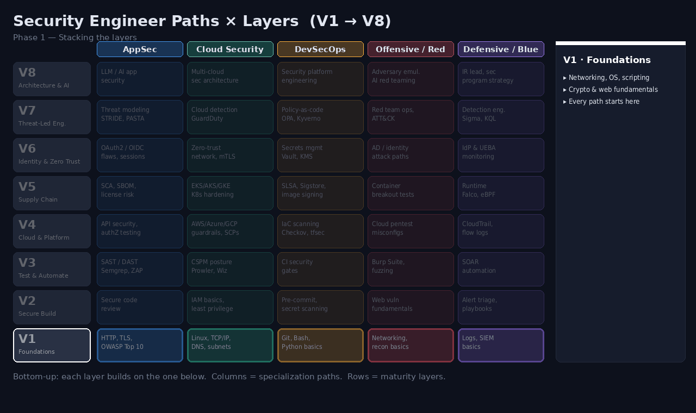

# Security Engineer Paths × Layers (V1 → V8)

A visual, interactive roadmap that maps **five security engineering specializations** across **eight maturity layers**, from foundations to architecture and AI security.



**Live demo:** https://mail2ramya17.github.io/security-engineer-paths/

## Why this exists

Security career advice is usually either a flat list of tools or a single-track roadmap. In practice, AppSec, Cloud Security, DevSecOps, Red and Blue teams grow through the *same* maturity stages, just with different tools at each stage. This grid shows them side by side, so you can:

- see where you are today in each path
- spot the adjacent skill one layer up
- see how paths connect (e.g. IaC scanning in DevSecOps ↔ cloud guardrails ↔ cloud pentest)

## The matrix

| Layer | AppSec | Cloud Security | DevSecOps | Offensive / Red | Defensive / Blue |
|---|---|---|---|---|---|
| **V8** Architecture & AI | LLM / AI app security | Multi-cloud security architecture | Security platform engineering | Adversary emulation, AI red teaming | IR lead, security program strategy |
| **V7** Threat-Led Eng. | Threat modeling (STRIDE, PASTA) | Cloud detection (GuardDuty) | Policy-as-code (OPA, Kyverno) | Red team ops, ATT&CK | Detection eng. (Sigma, KQL) |
| **V6** Identity & Zero Trust | OAuth2 / OIDC flaws, sessions | Zero-trust network, mTLS | Secrets mgmt (Vault, KMS) | AD / identity attack paths | IdP & UEBA monitoring |
| **V5** Supply Chain | SCA, SBOM, license risk | EKS/AKS/GKE, K8s hardening | SLSA, Sigstore, image signing | Container breakout tests | Runtime (Falco, eBPF) |
| **V4** Cloud & Platform | API security, authZ testing | AWS/Azure/GCP guardrails, SCPs | IaC scanning (Checkov, tfsec) | Cloud pentest, misconfigs | CloudTrail, flow logs |
| **V3** Test & Automate | SAST / DAST (Semgrep, ZAP) | CSPM posture (Prowler, Wiz) | CI security gates | Burp Suite, fuzzing | SOAR automation |
| **V2** Secure Build | Secure code review | IAM basics, least privilege | Pre-commit, secret scanning | Web vuln fundamentals | Alert triage, playbooks |
| **V1** Foundations | HTTP, TLS, OWASP Top 10 | Linux, TCP/IP, DNS, subnets | Git, Bash, Python basics | Networking, recon basics | Logs, SIEM basics |

Read it bottom-up: each layer builds on the one below.

## Features

- **Interactive grid**: click a layer to stack it, click a cell for detail, or press *Play* to animate V1 → V8
- **Data-driven**: all content lives in [`data/roadmap.json`](data/roadmap.json), so you can edit it without touching the UI
- **Zero dependencies**: one HTML file and one JSON file, hosted free on GitHub Pages

## Run locally

```bash
git clone https://github.com/mail2ramya17/security-engineer-paths.git
cd security-engineer-paths
python3 -m http.server 8000
# open http://localhost:8000
```

## Repo structure

```
.
├── index.html                 # interactive roadmap (GitHub Pages entry point)
├── data/roadmap.json          # paths, layers and cell content
├── assets/security_engineer_paths_v1_v8.gif
├── LICENSE
└── README.md
```

## Contributing

Suggestions for tools or skills at any layer are welcome. Open an issue or PR that edits `data/roadmap.json` and the matrix table above.

## Author

**Ramya Kanderi**, Senior Application Security & DevSecOps Engineer
[LinkedIn](https://linkedin.com/in/ramya-kanderi) · [GitHub](https://github.com/mail2ramya17)

## License

MIT, see [LICENSE](LICENSE).
